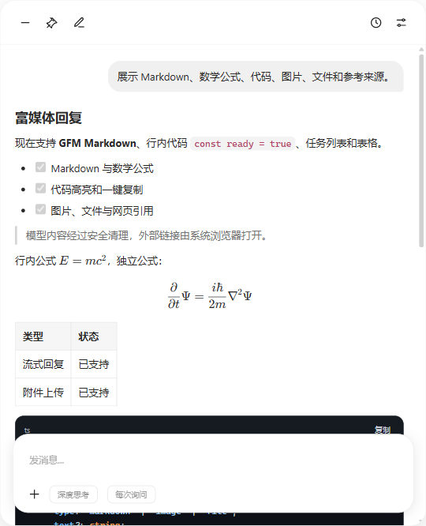
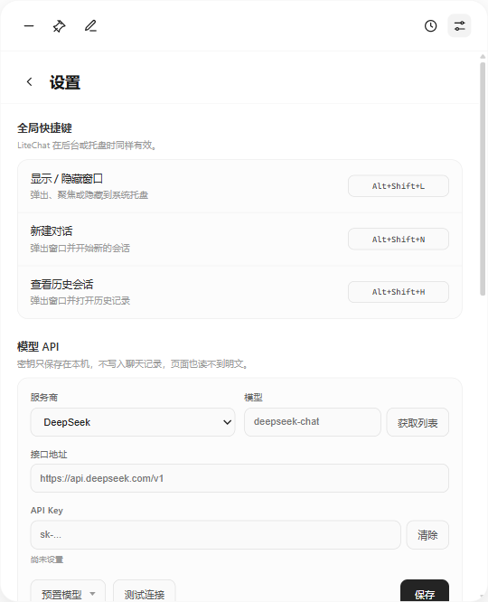
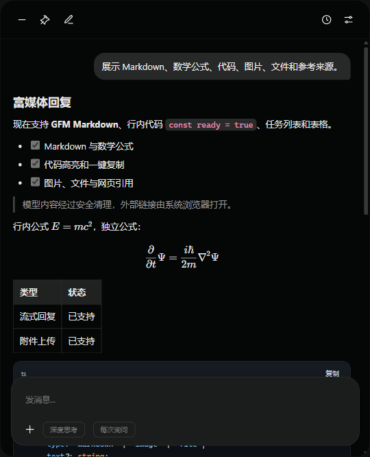

# LiteChat

一个轻量的桌面 AI 助手：Tauri 2 + 原生 JavaScript，常驻托盘，接入任意 OpenAI 兼容接口，并自带一套本地文件与命令行工具。



## 特性

- **任意 OpenAI 兼容接口**：DeepSeek、Ollama、本地网关都行，密钥只存在本机
- **工具调用**：内置 `shell` 服务，可执行 PowerShell、读写文件、搜索内容
- **MCP 协议**：可接入任意 stdio MCP 服务，也能让模型自己添加
- **附件解析**：拖入 PDF / Excel / Word / 文本，模型按需读取
- **流式渲染**：Markdown、KaTeX 公式、代码高亮、表格、图片、引用
- **生成中可插话**：回复未写完时也能发消息，插在下一段正文之前
- **本地历史**：SQLite 保存会话，重启后接着聊
- **深浅色主题**：跟随系统



<details>
<summary>暗色主题</summary>



</details>

## 下载与启动

需要 Node 18+、Rust 工具链和 Tauri 的系统依赖。

PDF 解析依赖 `src-tauri/libs/pdfium.dll`（Windows x64，约 7.6 MB），已随仓库提供，打包时会自动带上。要换其他平台时，从 [pdfium-binaries](https://github.com/bblanchon/pdfium-binaries/releases/tag/chromium%2F8125) 下载对应版本，**build 号必须与 `pdfium-render` 绑定的版本一致**（当前 8125）。

```powershell
pnpm install
pnpm tauri dev      # 开发
pnpm tauri build    # 打包
```

访问 `?demo=1` 可加载一份不写入历史库的富消息演示。

## 模型配置

打开设置 → 模型 API，填接口地址、模型名和密钥。

| 项目 | 说明 |
| --- | --- |
| 服务商 | DeepSeek 或自定义（任何 OpenAI 兼容服务） |
| 接口地址 | 如 `https://api.deepseek.com/v1`、`http://localhost:11434/v1` |
| 模型 | 可点「获取列表」从 `/v1/models` 拉取 |
| API Key | 本地地址可留空；密钥不会写进聊天记录 |

「测试连接」会发一次最小请求验证地址和密钥，失败时显示服务端返回的具体原因。

**推理强度**：输入栏的「深度思考」按钮可切 关闭 / 低 / 中 / 高，按 OpenAI 的 `reasoning_effort` 字段发送，关闭时不发该字段。设置是全局持久化的。

## 工具

内置 `shell` 服务，无需配置即可使用。

### 文件工具

| 工具 | 用途 |
| --- | --- |
| `read_file` | 读取文本文件，带行号 |
| `write_file` | 整体写入或覆盖 |
| `edit_file` | 精确替换一段原文，要求唯一匹配 |
| `list_dir` | 列出目录内容 |
| `search` | 按关键字或正则搜索文件内容 |
| `read_document` | 解析 PDF / Excel / Word / 文本 |
| `read_binary_info` | 查看文件的真实类型和编码 |

**工作目录**：所有相对路径都基于设置里的工作目录，默认是 `.litechat/workspace/`。工具无法访问该目录之外的文件。

### 命令工具

`run_command` 执行 PowerShell，`run_shell` 执行 cmd。未指定 `cwd` 时在工作目录下运行，结果末尾会回显实际执行位置。

### 附件处理

拖入或选择文件后：

- **图片**：走多模态通道，模型直接看图
- **其他文件**：存到 `<工作目录>/uploads/`，消息里只带路径，模型需要时调 `read_document` 读取

支持的格式：

| 类型 | 支持情况 |
| --- | --- |
| txt / md / 代码 / `.cmd` / `.bat` | 完整支持，非 UTF-8 时按系统代码页解码 |
| Excel（xlsx / xls） | 完整支持，按工作表输出 |
| Word（docx） | 完整支持 |
| PDF | 文字层完整支持，含中文（GBK-EUC-H 等编码）；扫描件无文字层时会提示 |
| PPT | 不支持，请另存为 PDF |

> PDF 解析基于 PDFium（Chrome 同款引擎），中文 PDF 可正常提取。扫描版 PDF 没有文字层，需要先行 OCR 或截图后作为图片上传。

### MCP 服务

设置页可添加外部 MCP 服务，通过 stdio 启动。修改后点「保存并重连」，状态会显示工具数量和连接错误。

模型也可以通过 `add_mcp_server` / `remove_mcp_server` 自行添加和移除服务。

## 工具执行权限

输入栏的权限按钮控制工具调用是否需要确认：

| 模式 | 行为 |
| --- | --- |
| 每次询问 | 敏感操作前弹窗 |
| 会话内记住 | 本会话允许过的工具不再问 |
| 全部允许 | 直接执行 |

只读工具（`read_*`、`list_*`、`get_*`、`search*`）默认免确认。写文件、执行命令、增删 MCP 服务需要确认，`delete_files` 在任何模式下都要逐个确认。

## 快捷键

设置页可自定义，默认：

| 快捷键 | 作用 |
| --- | --- |
| `Alt+Shift+L` | 显示 / 隐藏窗口 |
| `Alt+Shift+N` | 新建对话 |
| `Alt+Shift+H` | 查看历史 |

全局生效，窗口在后台或托盘时同样可用。

## 托盘

左键切换窗口显示，右键菜单提供显示、隐藏、退出。关闭窗口默认隐藏到托盘而非退出。

## 数据位置

| 文件 | 内容 |
| --- | --- |
| `.litechat/history.db` | 会话和消息 |
| `.litechat/models.json` | 模型配置（含密钥） |
| `.litechat/permissions.json` | 工具授权偏好 |
| `.litechat/shortcuts.json` | 快捷键 |
| `.litechat/workspace/` | 文件工具的默认工作目录 |
| `.litechat/workspace/uploads/` | 上传的附件 |

用 `LITECHAT_CONFIG_DIR` 环境变量可覆盖整个配置目录。

## 项目结构

```text
src/                     前端
├── app/                 外壳、视图框架、图标
├── chat/                消息渲染、流式回复、输入框、历史
├── render/              Markdown / 媒体卡片
├── settings/            设置页各分区
├── ui/                  右键菜单、快捷键录制
└── styles/              样式

src-tauri/               后端
└── src/
    ├── agent/           提供商、对话循环、消息投影、文档解析
    ├── app/             存储、路径、快捷键、托盘、剪贴板
    └── tools/mcp/       文件工具、命令工具、MCP 客户端、附件落盘
```

详见 [src/README.md](src/README.md)。

## 安全说明

- 模型返回的 HTML 经 DOMPurify 清理，外部链接通过系统浏览器打开
- API 密钥只存在本机配置文件，不写入聊天记录，无法从页面读取
- 文件工具被限制在工作目录内，路径穿越会被拒绝
- 执行命令和写文件默认需要确认

## 已知限制

- **扫描版 PDF**：没有文字层，无法提取。需要先 OCR 或截图后作为图片上传
- **PPT**：不支持
- **PDF 内嵌图片**：已能导出，但尚未在真实文档上充分验证

## 许可

MIT
